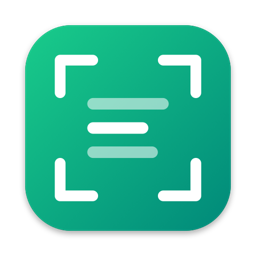

# CopyVisible

Copy anything you can see on your Mac. Press a shortcut, drag over any part
of the screen, and the text in it goes to your clipboard. Then Apple's AI, on
your Mac, can explain it, sum it up, shorten it or translate it.

Free and open source. No account, no server, no tracking.

**[copyvisible.bnapier.dev](https://copyvisible.bnapier.dev)**

## Install

[Download CopyVisible](https://github.com/barry-napier/copyvisible/releases/latest/download/CopyVisible.dmg),
open it, and drag CopyVisible to Applications. CopyVisible updates itself.

Needs macOS 26 or later and an Apple Silicon Mac. Smart actions need Apple
Intelligence turned on. Copying text works without it.

## Use

1. Press **⇧⌘2** and drag over some text. Or click a window to take all of it.
   Esc cancels.
2. The text is on your clipboard. A panel shows it next to what you captured.
3. In the panel you can:
   - **Copy as** Plain, Markdown, CSV, JSON or snake_case.
   - Turn **Join broken lines** on or off.
   - Click **quick links**: links, emails, phone numbers, addresses, and dates
     (add to Calendar or Reminders). A contact card goes to Contacts.
   - Run a **smart action**: Explain, Summarize, Make concise, Fix text,
     Translate, or your own instruction. Code also gets Find the bug, Add
     comments and Change language. Logs get What went wrong?
   - **Ask about it**: type a question and keep asking.
   - **Read aloud**.

More from the menu bar icon:

| Shortcut | What it does |
| --- | --- |
| ⇧⌘2 | Capture text |
| ⌥⇧⌘2 | Capture the same box again |
| ⌃⇧⌘2 | Watch a box (like subtitles). Each new line is added and copied. Press again to stop. |

You can change the shortcuts in Settings. CopyVisible never takes the system
screenshot keys.

- **Drop a picture or PDF** on the menu bar icon to read it. **Read Picture on
  Clipboard** reads a screenshot you already took.
- **History** lets you search past captures by words, app or date. Keep them for
  30 days, a year, or forever, or turn history off.
- **Shortcuts app**: Capture Text from Screen, Read Text in Picture, Get Last
  Capture, and Run Smart Action.

## What it knows

Each capture is sorted into a kind, and the panel changes to match:

| Kind | What changes |
| --- | --- |
| Code | Keeps lines and indentation. Explain and Find the bug come first. |
| Log or error | Keeps lines. What went wrong? comes first. |
| Table | Copies as cells (tabs), so it pastes into Numbers, Excel and Sheets. |
| Contact | Add to Contacts. |
| QR code | Copies what the code says. |
| Text | Joins lines that only wrapped. |

## Privacy

- Text is read by Apple's Vision framework on your Mac. Smart actions use
  Apple's on-device model. Nothing is sent anywhere.
- CopyVisible looks at the screen only when you capture, and only at the part
  you pick. macOS calls this permission Screen Recording. It never records video.
- History is stored only in `~/Library/Application Support/CopyVisible`. Delete
  All really deletes it.
- Add to Contacts opens a card in Contacts, which asks before saving.
  CopyVisible never reads your contacts. Calendar and Reminders ask the first
  time you add something.
- The only network use is updates: checking for them and downloading them
  from this repository's releases.
- The debug log is in `~/Library/Logs/CopyVisible`. It never holds captured text.

## Why not the Mac App Store?

It could be, but this way it ships the same day, updates itself, and anyone can
build exactly what they download.

## Build from source

You need Xcode 26 or later, [XcodeGen](https://github.com/yonaskolb/XcodeGen)
(`brew install xcodegen`) and an Apple Development certificate.

```sh
./scripts/build.sh
```

This builds, signs with your certificate, installs to `/Applications`, and
relaunches CopyVisible. Always use it for test builds: a stable path and
signature keep macOS from forgetting the Screen Recording permission. On first
run it writes your Team ID to `Config/Local.xcconfig`, which is not committed.

The Xcode project is generated from `project.yml`. Edit that, not the project.

### Tests

```sh
xcodebuild -project CopyVisible.xcodeproj -scheme CopyVisible \
  -destination "platform=macOS,arch=arm64" test   # reading, sorting, formats
./scripts/selftest.sh                             # debug build: whole app, plus smart actions
```

The self-test draws sample pictures (code, a log, a contact, a paragraph),
reads them through the app, checks the results, and tries smart actions. It
needs no Screen Recording. It also saves pictures of the app's windows to
`~/Library/Logs/CopyVisible/shots`.

### Releases

`./scripts/ship.sh 0.2.0` pushes a version tag. GitHub Actions then builds,
signs, notarizes and publishes it (`.github/workflows/release.yml`), and
installed copies offer the update. `./scripts/release.sh` does the same on a
Mac. The workflow file lists the secrets it needs.

### Website

`site/` is the page at copyvisible.bnapier.dev. It is plain HTML, CSS and JavaScript.

## License

MIT. See [LICENSE](LICENSE).
